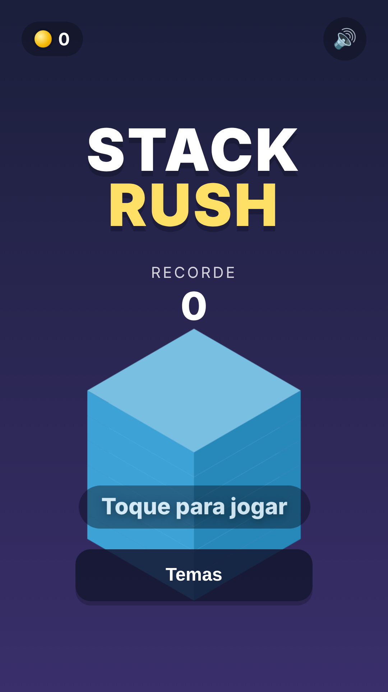
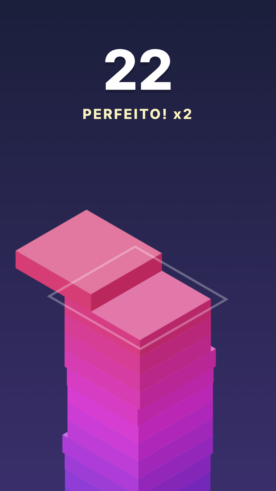
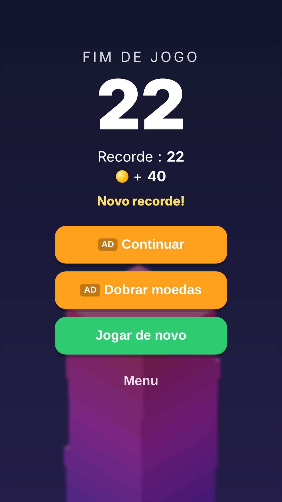
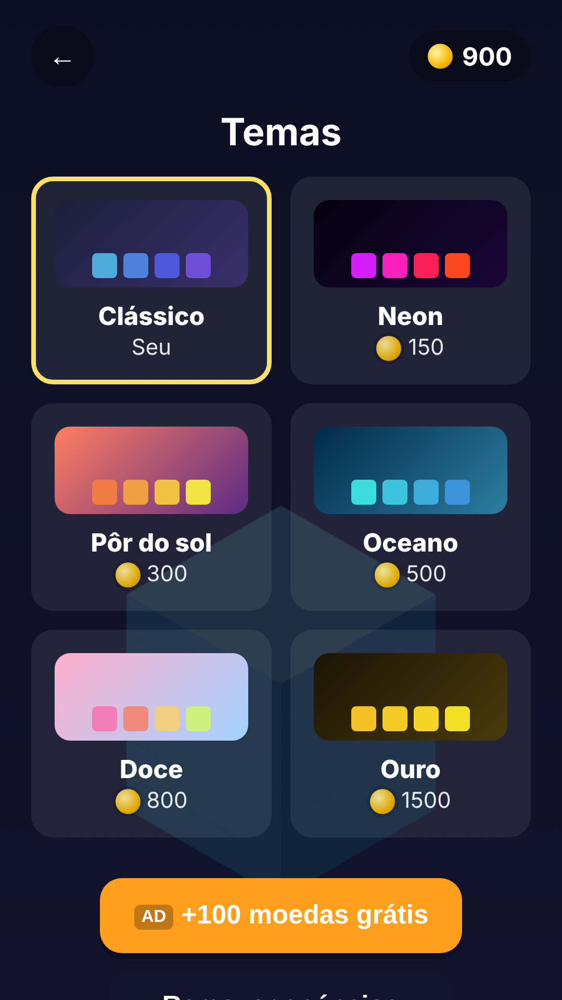

# Stack Rush

Jogo hyper-casual de empilhar blocos com um toque. O bloco desliza; toque para soltar.
O que passar da borda é cortado. Acertos perfeitos seguidos fazem o bloco crescer de novo.

**Jogue no navegador:** https://wallaceluis.github.io/stack-rush/

| Menu | Jogo | Fim de jogo | Temas |
|---|---|---|---|
|  |  |  |  |

## Como o jogo ganha dinheiro

| Ponto | Formato | Onde |
|---|---|---|
| Continuar a partida | Vídeo premiado | Fim de jogo (1x por partida, a partir de 3 pontos) |
| Dobrar moedas | Vídeo premiado | Fim de jogo |
| +100 moedas grátis | Vídeo premiado | Tela de temas |
| Intersticial | Tela cheia | Ao sair do fim de jogo, a cada 3 partidas e no mínimo 45 s entre um e outro |
| Banner adaptativo | Banner | Só no menu, fim de jogo e temas (nunca durante a partida, para não gerar clique acidental) |
| Remover anúncios | Compra única (`remove_ads`) | Tela de temas |

## Zonas e missões

A cada 15 andares o jogo entra numa zona nova, com uma regra diferente:

| Andares | Zona | O que muda |
|---|---|---|
| 0–14 | Calmaria | Normal |
| 15–29 | Ventania | A velocidade do bloco oscila |
| 30–44 | Espelho | O bloco pode vir de qualquer lado |
| 45–59 | Turbo | 25% mais rápido |
| 60+ | Caos | Tudo junto |

Cada zona alcançada vale +10 moedas. Há sempre 3 missões ativas (pontuação, perfeitos seguidos, zona,
partidas, blocos no total) que pagam moedas e ficam mais difíceis conforme o jogador completa.

As moedas desbloqueiam 6 temas de cores, o que dá motivo para o jogador voltar e assistir vídeos premiados.
Há também bônus diário de 50 moedas.

As regras de frequência ficam no topo de `app/src/main/assets/game/game.js`.

## Estrutura

```
app/src/main/assets/game/   o jogo em si (HTML5 canvas, sem dependências)
  game.js                   lógica, telas, loja, regras de anúncios
  platform.js               ponte com o Android; no navegador simula os anúncios
app/src/main/java/.../
  MainActivity.kt           WebView em tela cheia
  GameBridge.kt             funções que o JS chama (window.Android)
  AdsManager.kt             AdMob + consentimento (UMP/GDPR)
  BillingManager.kt         Google Play Billing (remover anúncios)
store/                      ícone 512, feature graphic e screenshots para a Play Store
```

Para testar no navegador, basta abrir `app/src/main/assets/game/index.html`.
A mesma pasta serve para publicar em portais web (itch.io, CrazyGames, Poki).

## Build

O GitHub Actions gera tudo a cada push na `main` (aba **Actions** → último build → *Artifacts*):

- `stack-rush-debug-apk`: APK para instalar direto no celular e testar.
- `stack-rush-release`: APK e AAB de release (o AAB é o que vai para a Play Store).

Localmente (precisa do Android SDK): `./gradlew assembleDebug bundleRelease`.

## Publicar na CrazyGames (web, sem custo)

O jogo já usa o SDK v3 da CrazyGames: vídeo premiado e intersticial pelo portal, `gameplayStart/Stop`,
`happytime` no recorde, áudio mudo durante anúncios e progresso salvo na conta do jogador.
O botão "remover anúncios" some fora do Android, como o portal exige.

1. Gere o pacote: `scripts/build-crazygames.sh` (ou baixe o artifact `stack-rush-crazygames` do Actions).
2. Crie a conta em https://developer.crazygames.com e envie o conteúdo de `dist/crazygames` (o `.zip`).
3. Use `store/` para capa e screenshots. Orientação: retrato; controles: toque, clique ou espaço.

O mesmo pacote sem o SDK (a pasta `assets/game`) serve para itch.io ou GameDistribution.

## Checklist para publicar na Play Store

1. **AdMob**: crie o app em https://admob.google.com, crie 3 blocos (banner adaptativo, intersticial, premiado)
   e coloque os IDs em `gradle.properties` ou como secrets do repositório
   (`ADMOB_APP_ID`, `ADMOB_BANNER_ID`, `ADMOB_INTERSTITIAL_ID`, `ADMOB_REWARDED_ID`).
   Sem IDs, o app usa os IDs de teste do Google.
2. **Chave de assinatura** (uma vez só, guarde bem):
   ```
   keytool -genkey -v -keystore upload.jks -keyalg RSA -keysize 2048 -validity 10000 -alias upload
   base64 -w0 upload.jks   # cole o resultado no secret SIGNING_KEYSTORE_BASE64
   ```
   Secrets: `SIGNING_KEYSTORE_BASE64`, `SIGNING_STORE_PASSWORD`, `SIGNING_KEY_ALIAS` (=upload), `SIGNING_KEY_PASSWORD`.
3. **Play Console** (taxa única de US$ 25): crie o app, envie o AAB, use os arquivos de `store/`,
   publique a política de privacidade (`PRIVACY.md`, dá para servir pelo GitHub Pages) e
   preencha "Contém anúncios: sim".
4. **Compra "remover anúncios"**: em *Monetizar → Produtos no app*, crie o produto `remove_ads`.
5. **app-ads.txt**: o AdMob vai pedir um arquivo `app-ads.txt` no site do desenvolvedor informado na Play Store.

Pacote: `com.wallaceluis.stackrush` (troque em `app/build.gradle.kts` antes da primeira publicação, se quiser).
